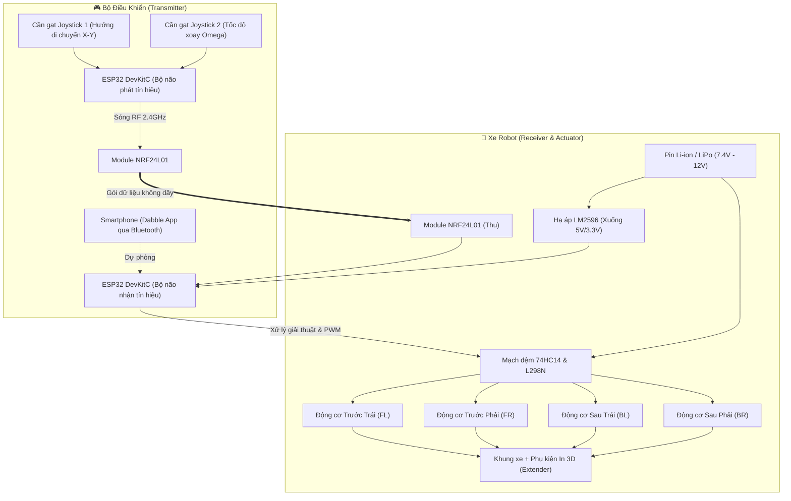

# ⚽ ROBOTINO - HỆ THỐNG XE ĐÁ BÓNG TỰ HÀNH & ĐIỀU KHIỂN CHIẾN THUẬT
> **Dự án tranh tài tại cuộc thi thiết kế xe đá bóng "Launchtime 9th Football Car Design Competition"**  
> *Đơn vị tổ chức: Ban đại diện Sinh viên Khoa Điện - Điện tử (EEE Student's Association)*

---

## 📖 1. Giới thiệu tổng quan (Dành cho người không chuyên - Non-tech)

### Dự án này là gì? (What is this?)
Hãy tưởng tượng một trận bóng đá 2 người (2 vs 2 hoặc 2 vs Robot) thu nhỏ trên mặt sân mini, nhưng các cầu thủ không phải là người chạy bằng chân mà là **những cỗ xe robot thông minh** được chế tạo từ động cơ, vi mạch và cảm biến. 

Đội hình của chúng tôi gồm **2 chiếc xe chiến thuật**:
1. 🎯 **Xe Tiền Đạo (Striker)**: Nhỏ gọn, linh hoạt, tăng tốc nhanh, có "mũi chắn/hướng bóng" được thiết kế riêng bằng in 3D để dẫn bóng, xoay chuyển và sút tung lưới đối thủ.
2. 🛡️ **Xe Thủ Môn (Goalkeeper / Blocker)**: Vững chắc, trang bị tấm chắn dài phía trước để bịt kín góc sút, cản phá các pha tấn công nguy hiểm và bảo vệ khung thành.

Cả hai xe đều được điều khiển từ xa với độ trễ cực thấp, có thể thực hiện những pha di chuyển đa hướng ảo diệu (đi ngang, đi chéo, xoay 360 độ) như các cầu thủ chuyên nghiệp.

```
       [ KHUNG THÀNH NHÀ ]
                │
         [🛡️ XE THỦ MÔN] (Blocker Extender chắn bóng rộng)
                │
                │     ⚽ (Quả bóng)
                │
         [🎯 XE TIỀN ĐẠO] (Striker Extender gom bóng & sút)
                │
      ═════════════════════ (Vạch giữa sân)
                │
       [ KHUNG THÀNH ĐỐI THỦ ]
```

---

## 🎯 2. Mục tiêu dự án (What I Do)

- **Thiết kế phần cứng hoàn chỉnh**: Tự thiết kế và chế tạo bo mạch điện tử (PCB), không chỉ ghép module rời mà tối ưu hóa thành mạch chuyên dụng nhỏ gọn trên phần mềm KiCad.
- **Tối ưu hóa cơ khí thi đấu**: Ứng dụng công nghệ in 3D để tạo ra các cơ cấu mở rộng (Extender) chuyên biệt cho từng vai trò trên sân.
- **Hệ thống điều khiển kép (Dual Control System)**:
  - *Chính thức*: Tay cầm joystick công thái học giao tiếp sóng vô tuyến siêu tốc NRF24L01 (2.4GHz).
  - *Dự phòng khẩn cấp*: Kết nối Bluetooth qua ứng dụng điện thoại thông minh (Dabble App).
- **Thuật toán điều khiển chuyển động**: Lập trình chuyển động đa hướng (Mecanum Kinematics) và chuyển động vi sai (Differential Drive), lọc nhiễu cần gạt điều khiển và tự động dừng xe khi mất sóng (Failsafe).

---

## 🛠️ 3. Cách thức vận hành kỹ thuật (How I Do)

Hệ thống được cấu thành từ 3 trụ cột chính: **Cơ khí - Điện tử - Phần mềm**.



### 3.1. Phần Cứng & Bo Mạch (Hardware Architecture)
1. **Bộ điều khiển cầm tay (`DIỀU KHIỂN PRO MAX`)**:
   - Sử dụng vi điều khiển **ESP32** mạnh mẽ.
   - 2 cụm Joystick PS2 chuẩn xác.
   - Mạch nguồn tích hợp bảo vệ dòng **RT9742BNGJ5F** và tụ lọc giúp tín hiệu mượt mà, không bị sụt nguồn khi đẩy joystick tối đa.
2. **Bo mạch công suất xe (`L298N ROBOTINO`)**:
   - Mạch cầu H kép **L298N** điều khiển 4 kênh động cơ kéo bánh.
   - IC đệm đảo/Schmitt Trigger **74HC14** cách ly và bảo vệ chân tín hiệu xung của vi điều khiển, khử nhiễu kích xung PWM.
   - Mạch chuyển đổi nguồn hạ áp **LM2596S** cấp nguồn 5V ổn định cho ESP32 và module RF từ khối pin chính.
3. **Phụ kiện in 3D (`Extender STLs`)**:
   - `Striker Extender.stl`: Tấm gom bóng phía trước xe tấn công, giúp bóng bám chặt vào mũi xe khi rê dắt ở tốc độ cao.
   - `Blocker Extender.stl`: Tấm chắn ngang rộng phía trước xe thủ môn, tối ưu hóa diện tích che chắn cầu môn.

---

### 3.2. Phần Mềm & Giải Thuật (Software & Kinematics)

Hệ thống hỗ trợ 2 mô hình truyền động:

#### A. Thuật toán bánh đa hướng Mecanum (Mecanum Kinematics)
Cho phép xe tạt ngang sang trái/phải, đi chéo 45 độ hoặc vừa xoay vừa chạy mà không cần đánh lái:

$$
V_{FL} = V_{\text{power}} \cdot \frac{\cos(\theta + \pi/4)}{\max\left(\lvert\sin(\theta + \pi/4)\rvert, \lvert\cos(\theta + \pi/4)\rvert\right)} + \omega
$$

$$
V_{FR} = V_{\text{power}} \cdot \frac{\sin(\theta + \pi/4)}{\max\left(\lvert\sin(\theta + \pi/4)\rvert, \lvert\cos(\theta + \pi/4)\rvert\right)} - \omega
$$

$$
V_{BL} = V_{\text{power}} \cdot \frac{\sin(\theta + \pi/4)}{\max\left(\lvert\sin(\theta + \pi/4)\rvert, \lvert\cos(\theta + \pi/4)\rvert\right)} + \omega
$$

$$
V_{BR} = V_{\text{power}} \cdot \frac{\cos(\theta + \pi/4)}{\max\left(\lvert\sin(\theta + \pi/4)\rvert, \lvert\cos(\theta + \pi/4)\rvert\right)} - \omega
$$

Trong đó:
- $V_{FL}, V_{FR}, V_{BL}, V_{BR}$: Vận tốc xung PWM cấp cho 4 bánh (Trước-Trái, Trước-Phải, Sau-Trái, Sau-Phải).
- $V_{\text{power}} \in [0, 255]$: Công suất tổng (độ lớn lực đẩy từ Joystick).
- $\theta$: Góc hướng di chuyển tính bằng Radian ($\text{atan2}(y, x)$).
- $\omega \in [-255, 255]$: Tốc độ góc xoay thân xe tại chỗ.
- **Chuẩn hóa tốc độ (Normalization)**: Nếu giá trị tuyệt đối lớn nhất trong 4 bánh vượt ngưỡng cực đại ($255$), toàn bộ 4 bánh sẽ được chia tỷ lệ đồng dạng theo `max_speed` để xe giữ đúng góc quỹ đạo $\theta$ mà không bị méo hướng.

#### B. Thuật toán Joystick "Square to Circle Mapping"
Joystick thông thường trả về tọa độ trong khung hình vuông, dẫn đến việc đẩy góc chéo xe sẽ nhận giá trị lớn hơn đẩy thẳng. Trong code tay cầm:

$$
x_{\text{circular}} = x \cdot \sqrt{1 - \frac{y^2}{2}}
$$

$$
y_{\text{circular}} = y \cdot \sqrt{1 - \frac{x^2}{2}}
$$

Thuật toán giúp người lái có cảm giác vê cần số đồng đều và mượt mà ở mọi hướng.

#### C. Chế độ điều khiển vi sai (Differential Drive)
Khi cần lực đẩy lớn và độ bám sân cao, hệ thống kích hoạt cấu hình 4 bánh chạy đồng tốc theo 2 dải Trái - Phải với hệ số cân bằng `SCALE_LEFT`, `SCALE_RIGHT`.

---

## 🌟 4. Ưu điểm nổi bật (Advantages)

| Yếu tố | Giải pháp của Robotino | Giá trị mang lại |
| :--- | :--- | :--- |
| **Tính cơ động** | Tích hợp giải thuật Mecanum đa hướng | Xe có thể "trượt ngang" đón bóng hoặc luồn lách qua khe hẹp mà đối thủ dùng bánh thường không làm được. |
| **Độ trễ thấp** | Sóng vô tuyến NRF24L01+ 2.4GHz | Tốc độ đáp ứng gần như tức thì (~5-10ms), phản xạ đón bóng thần tốc. |
| **Dự phòng kép** | Sẵn sàng chuyển đổi sang Bluetooth điện thoại | Nếu tay cầm hết pin hoặc bị nhiễu sóng trong hội trường, đội có thể lấy smartphone ra lái ngay lập tức. |
| **Mạch in tối ưu** | Tự thiết kế PCB chuyên biệt trên KiCad | Loại bỏ mớ dây nối chằng chịt, giảm thiểu tối đa sự cố tuột dây, chập mạch khi va chạm nảy lửa trên sân. |
| **An toàn (Failsafe)** | Ngắt động cơ tức thì khi mất tín hiệu > 500ms | Xe không bao giờ bị "điên" đâm vào trọng tài hoặc khán giả khi mất kết nối. |
| **Tối ưu vai trò** | Cơ khí in 3D chuyên hóa (Striker vs Blocker) | Tăng tỷ lệ chặn bóng thành công cho thủ môn và tăng độ chính xác của cú sút cho tiền đạo. |

---

## ⚠️ 5. Nhược điểm & Thách thức còn tồn tại (Drawbacks & Future Improvements)

Mặc dù hệ thống vận hành tốt, dự án vẫn còn một số điểm hạn chế kỹ thuật cần khắc phục:

1. **Hiệu suất sinh nhiệt của Driver L298N**:
   - *Vấn đề*: L298N sử dụng công nghệ bóng bán dẫn BJT cũ, gây sụt áp khoảng $1.5\text{V} - 2\text{V}$ và tỏa nhiệt nhiều khi xe đẩy bóng lâu.
   - *Hướng cải tiến*: Nâng cấp sang IC MOSFET như **TB6612FNG** hoặc **DRV8833** để xe chạy mát hơn, tiết kiệm pin và bốc hơn.
2. **Độ bám sân của bánh Mecanum**:
   - *Vấn đề*: Bánh xe Mecanum có các con lăn con (rollers) dễ bị trượt nếu mặt sân có bụi hoặc thảm thi đấu trơn trượt, làm giảm lực đẩy khi tranh chấp tay đôi.
3. **Nhiễu tần số 2.4GHz tại nhà thi đấu**:
   - *Vấn đề*: Trong nhà thi đấu đông người có hàng trăm thiết bị phát Wi-Fi/Bluetooth, module NRF24 không có bộ khuếch đại công suất (PA+LNA) có thể bị chập chờn.
   - *Giải pháp*: Cần bổ sung anten rời và tính năng tự động nhảy kênh (Frequency Hopping).
4. **Đồng bộ hóa mã nguồn & Tinh chỉnh Code**:
   - *Ghi nhận mã nguồn*: Hiện tại code `Car_Normal.ino` đang có dòng gán bánh dưới phải (`EN4R`, `IN4R`) theo `leftSpeed` thay vì `rightSpeed`, cần sửa lại đúng biến để xe rẽ mượt.
   - Bản code nạp cho xe đang dùng chế độ Dabble Bluetooth làm mặc định, cần chuẩn hóa để gạt công tắc chọn linh hoạt giữa RF24 và Bluetooth.

---

## 📂 6. Cấu trúc thư mục mã nguồn & Thiết kế (Repository Structure)

```text
Robotino/
│
├── README.md                      # Tài liệu tổng quan dự án (Tài liệu này)
├── espressif-kicad-addon.zip      # Thư viện footprint linh kiện ESP32 cho KiCad
│
├── Extender STLs/                 # File thiết kế cơ khí 3D phục vụ in
│   ├── Blocker Extender.stl       # Tấm chắn bóng dành cho Xe Thủ Môn
│   └── Striker Extender.stl       # Càng dẫn & định vị bóng cho Xe Tiền Đạo
│
├── DI?U KHI?N PRO MAX/            # Thiết kế PCB mạch điều khiển cầm tay (KiCad)
│   ├── DI?U KHI?N PRO MAX.kicad_sch  # Sơ đồ nguyên lý tay cầm (Schematic)
│   ├── DI?U KHI?N PRO MAX.kicad_pcb  # Layout mạch in tay cầm (PCB)
│   └── PCB JOYSTICK.pretty/          # Thư viện footprint Joystick
│
├── L298N ROBOTINO/                # Thiết kế PCB mạch điều khiển động cơ trên xe (KiCad)
│   ├── L298N ROBOTINO.kicad_sch      # Sơ đồ nguyên lý mạch công suất & vi điều khiển
│   ├── L298N ROBOTINO.kicad_pcb      # Layout mạch in đặt trên xe
│   └── LM2596S.pretty/               # Thư viện module nguồn LM2596S
│
└── Source_code/                   # Toàn bộ mã nguồn lập trình vi điều khiển (Arduino/C++)
    ├── README.txt                 # Hướng dẫn tải thư viện phụ trợ (RF24 by TMRh20)
    ├── Car_Mecanum/               # Firmware nạp cho xe cấu hình bánh Mecanum
    ├── Car_Normal/                # Firmware nạp cho xe cấu hình bánh thường (Differential)
    ├── Controller_Mecanum/        # Firmware nạp cho tay cầm điều khiển xe Mecanum (RF24)
    ├── Controller_Normal/         # Firmware nạp cho tay cầm điều khiển xe bánh thường (RF24)
    └── Code_Dabble_Sample/        # Mã nguồn mẫu kết nối Smartphone qua ứng dụng Dabble
```

---

## 🚀 7. Hướng dẫn cài đặt & Vận hành nhanh (Quick Start)

### 7.1. Chuẩn bị thư viện trên Arduino IDE
Cài đặt các thư viện sau qua **Library Manager**:
- `RF24` (by TMRh20)
- `DabbleESP32` (by STEMpedia)

### 7.2. Nạp chương trình
1. **Tay cầm điều khiển**:
   - Mở file [Controller_Mecanum.ino](file:///c:/Users/TBC/.gemini/antigravity/scratch/Robotino/Source_code/Controller_Mecanum/Controller_Mecanum.ino).
   - Chọn board **ESP32 Dev Module** và cổng COM tương ứng, nhấn **Upload**.
2. **Xe Robot**:
   - Mở file [Car_Mecanum.ino](file:///c:/Users/TBC/.gemini/antigravity/scratch/Robotino/Source_code/Car_Mecanum/Car_Mecanum.ino).
   - Chọn board **ESP32 Dev Module**, nạp code và kiểm tra phản hồi trên Serial Monitor (Baudrate: `115200`).

### 7.3. Điều khiển bằng Smartphone (Phương án dự phòng)
1. Tải ứng dụng **Dabble** trên Google Play Store hoặc Apple App Store.
2. Bật Bluetooth trên điện thoại, quét tìm thiết bị:
   - `Robotino_Mecanum` (dành cho xe Mecanum)
   - `Robotino_Normal` (dành cho xe bánh thường)
3. Chọn mục **GamePad** trên màn hình điện thoại và điều khiển xe thi đấu.

---

<p align="center">
  <b>Tự hào chế tạo bởi Đội ngũ Kỹ thuật Robotino — Sẵn sàng cho cúp vô địch Launchtime 9th! 🏆</b>
</p>
